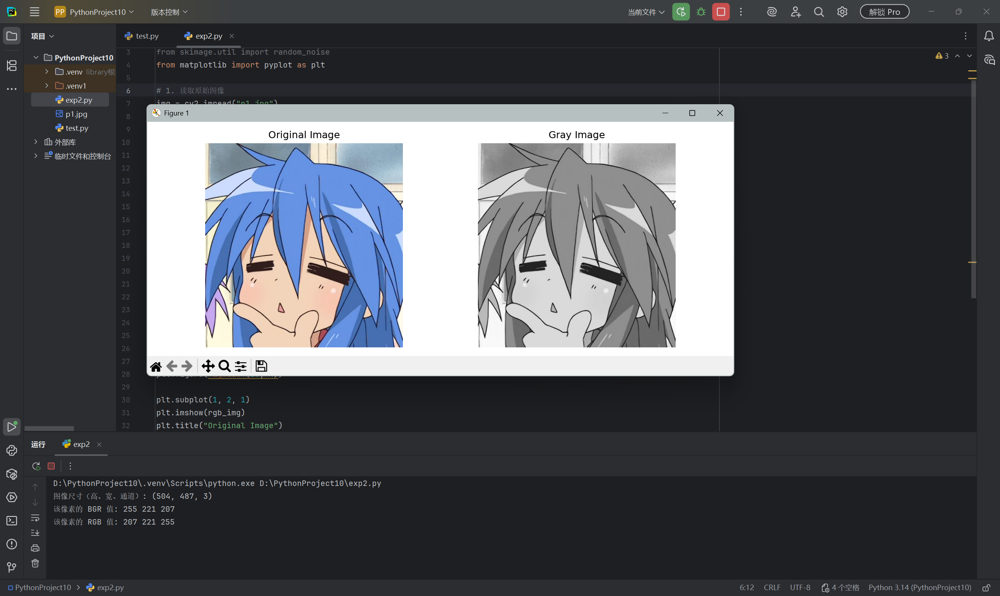
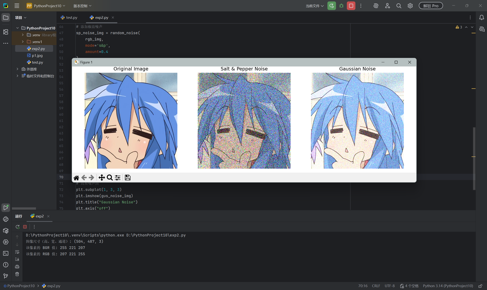
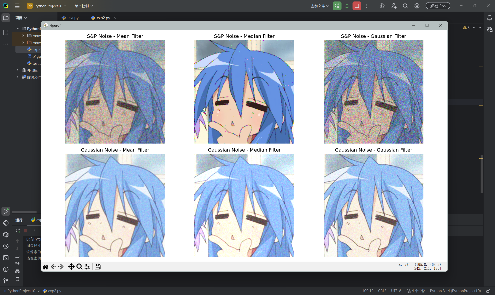
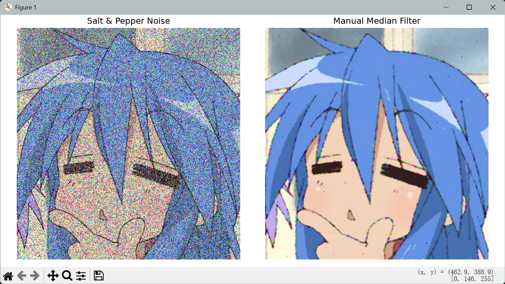

# 实验二：图像增强与滤波

## 实验目的
学习使用 OpenCV 读取图像、查看像素值及进行颜色空间转换；了解椒盐噪声和高斯噪声对图像的影响；比较均值、中值和高斯滤波的处理效果，并通过手动实现中值滤波理解其原理。

## 实验内容
1. 读取 `p1.jpg`，输出图像尺寸及 `[100, 100]` 位置的 BGR、RGB 像素值。
2. 将 BGR 图像转换为 RGB 和灰度图，显示处理结果。
3. 使用 `random_noise` 添加椒盐噪声（`amount=0.4`）及高斯噪声（`mean=0.2, var=0.03`）。
4. 对两种噪声分别应用 5×5 均值、中值、高斯滤波，共得到六种处理结果。
5. 对彩色图像的三个通道分别进行手动中值滤波：复制边缘填充，遍历每个像素，提取 5×5 邻域并取中位数。

## 实验结果与分析

以下四张图片是原实验运行截图，保留原文件，未重新生成。`code.ipynb` 由原脚本整理，执行后另存到 `generated/时间戳/`。随机噪声每次生成不同，因此新结果不要求与截图逐像素一致。

### 1. 原始图像与灰度图像

灰度图保留图像明暗和轮廓信息，不再包含原图的颜色信息。OpenCV 读取的彩色图像采用 BGR 通道顺序，使用 Matplotlib 显示前需要转换为 RGB，以避免颜色显示错误。

### 2. 噪声对比

椒盐噪声使部分通道值变为极小值或极大值，形成明显的离散噪点。对于彩色图像，按通道扰动也可能产生彩色噪点，不一定只表现为纯黑白像素。`amount=0.4` 表示较强的扰动比例，提高该参数通常会使受影响的元素更多。

高斯噪声使图像出现颗粒感。本实验设置的均值为 0.2，而非零均值，因此还带来了向上的亮度偏移；归一化结果会被截断到 [0,1]，亮部可能损失细节。图像变亮不能概括为所有高斯噪声的固有现象。

### 3. 六种滤波结果对比

第一行对应椒盐噪声，第二行对应高斯噪声；每行依次为均值、中值、高斯滤波。

对于椒盐噪声，中值滤波的视觉效果较好，人物轮廓和大面积颜色恢复得更清楚。均值滤波和高斯滤波通过邻域加权平均平滑图像，也会受到极值噪点影响，结果仍有噪声并出现模糊。

对于高斯噪声，均值和高斯滤波均能减轻颗粒感，但会损失部分边缘与细节。从截图看，高斯滤波后的画面更平滑。这里是对本次图像的视觉比较，未计算 PSNR、SSIM 等指标，不据此断言某种方法在所有情况下最优。滤波也不能直接消除非零均值造成的整体亮度偏移。

### 4. 手动中值滤波

处理后大部分密集噪点被去除，但局部边缘和细节附近仍存在残余噪点。噪声较强时，部分窗口的中位数仍可能受到污染；增加窗口通常可加强平滑，但也可能使细线和细节模糊，因此不应只追求噪点完全消失。

## 实验小结
本次实验完成了图像读取、灰度转换、添加噪声和滤波处理。通过对比发现，不同噪声适合的处理方法有所不同：中值滤波对本实验中的椒盐噪声更有效，高斯滤波能够平滑高斯噪声造成的颗粒感。手动实现中值滤波帮助理解了邻域取值、边界填充和中位数运算的过程。滤波在去噪的同时也可能损失细节，需要结合噪声强度与图像内容选择窗口大小。

## 文件与运行方法
- `exp2.py`：未经修改的原始脚本。
- `code.ipynb`：按步骤整理的 notebook；算法和噪声参数保留，增加路径处理、结果保存及手动结果比较。
- `p1.jpg`：原实验输入图像。
- `result/`：四张原运行截图，供本报告引用。
- `requirements.txt`：实验二依赖列表。

在安装依赖的 Python 环境中打开 `code.ipynb`，从上到下运行。工作目录应为 `2nd.exp` 或仓库根目录。手动实现采用逐像素循环，运行可能较慢。当前整理环境缺少 OpenCV 等依赖，未重新运行完整 notebook；已检查所有代码单元语法、文件完整性和报告图片链接。
