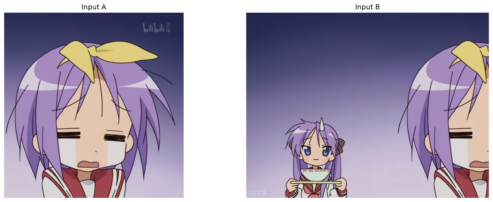
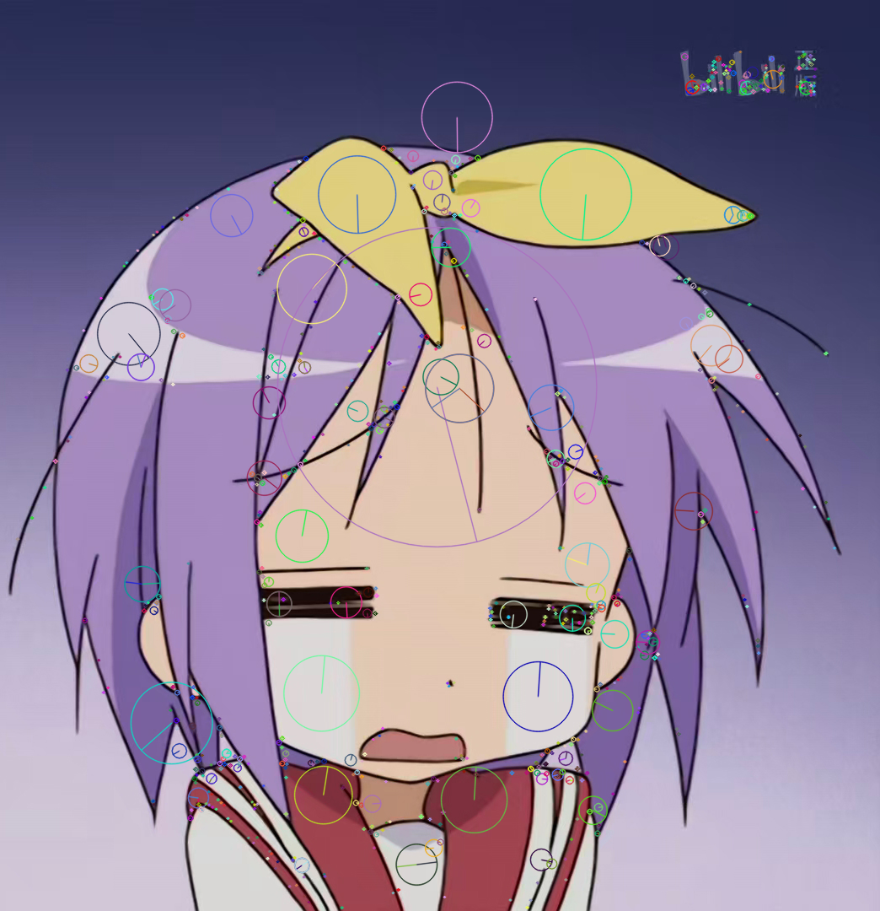
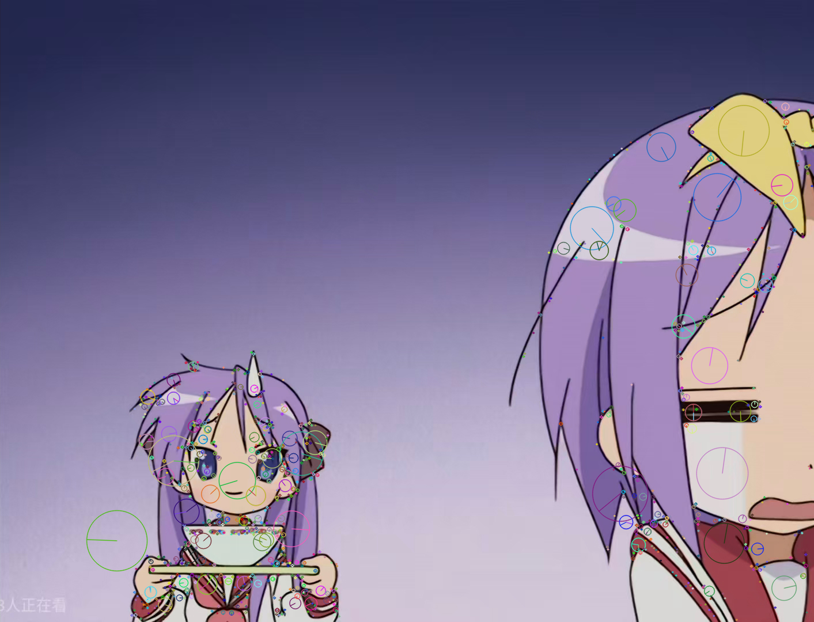
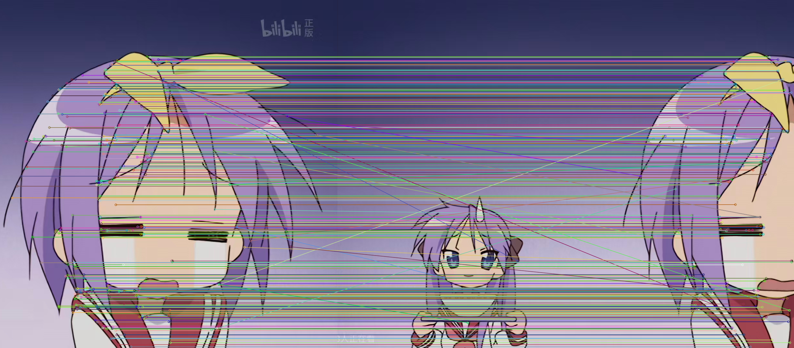
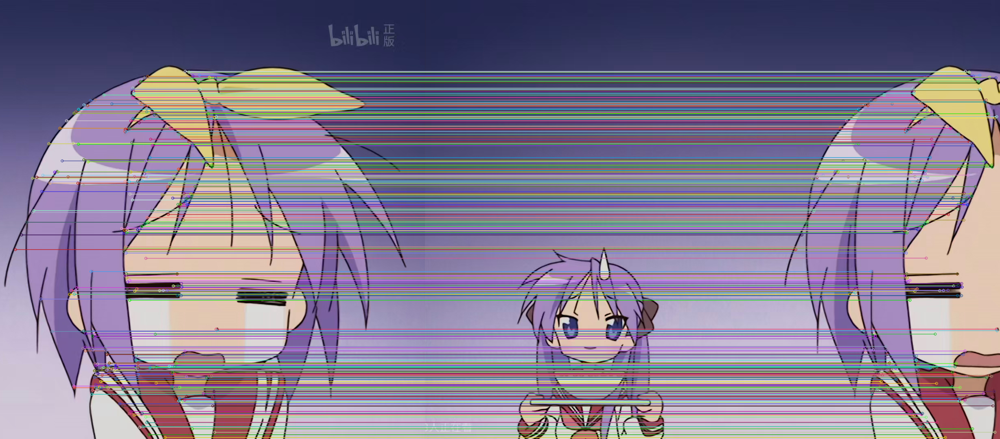
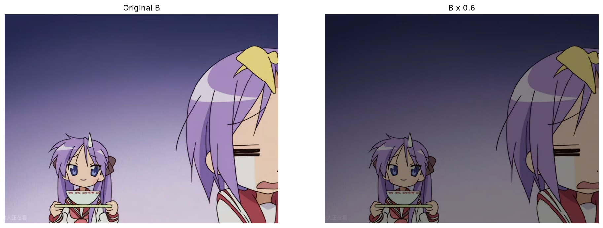
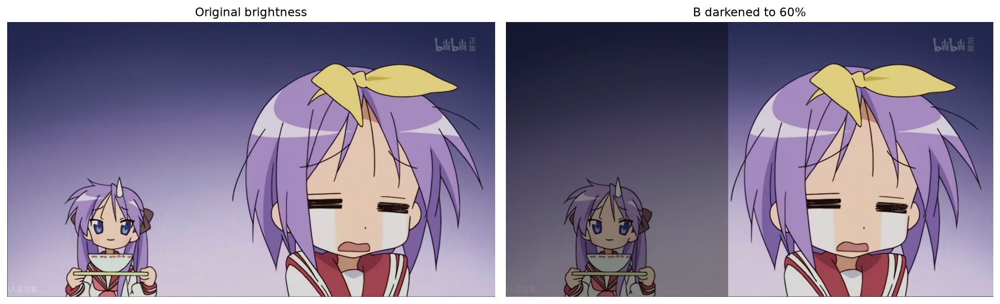

# 实验三：图像关键点检测与图像拼接

## 一、实验目的

学习使用 OpenCV 对具有重叠区域的两张图像进行关键点检测、特征匹配和自动拼接。通过 SIFT 提取局部特征，使用 FLANN 与 Lowe 比率测试筛选匹配，再用 RANSAC 估计单应矩阵，理解从特征对应关系到图像配准的过程。对图像 B 进行亮度缩放，比较特征数量、几何对齐与亮度接缝的变化。

## 二、实验内容与环境

本实验使用本人提供的 `img/a.jpg`、`img/b.jpg`，在已有 `code.ipynb` 的基础上整理为可从头执行的 [实验代码.ipynb](实验代码.ipynb)。原始 Notebook 和历史结果文件原样保留。实验指导截图用于核对步骤和历史观察，报告中的本次统计以重新执行的输出为准。

| 项目 | 配置 |
|---|---|
| Python | 3.14.6 |
| OpenCV | 4.13.0 |
| NumPy | 2.4.6 |
| Matplotlib | 3.11.0 |
| SIFT | `cv2.SIFT_create()`，默认参数 |
| FLANN | KD-Tree，`trees=5`、`checks=50`、`k=2` |
| 比率测试阈值 | 0.7 |
| RANSAC 重投影阈值 | 5.0 像素 |
| 亮度对照 | B 的像素值乘以 0.6，A 不变 |
| 可复现设置 | OpenCV 随机种子 42，计算线程数 1 |

实验不需要 PyTorch 或 GPU。环境安装和运行方式见 [运行说明](README.md)。本次验证为 2026 年 10 月 22 日执行；运行目录名保留执行环境生成的时间戳，仅用作结果标识。

## 三、实验原理

### 1. SIFT 关键点与描述符

SIFT 在尺度空间中寻找稳定的局部特征，并根据局部梯度方向生成描述符。本实验每个关键点对应一个 128 维向量。人物轮廓、头发和五官附近具有较丰富的局部结构，较容易产生关键点；平滑背景中的关键点较少。关键点数量反映可检测的局部信息，不能单独说明匹配质量。[OpenCV SIFT 官方说明](https://docs.opencv.org/4.13.0/da/df5/tutorial_py_sift_intro.html)

### 2. FLANN 与 Lowe 比率测试

为 A 的每个描述符在 B 中寻找两个近邻，设对应距离为 $d_1$、$d_2$，当 $d_1 < 0.7d_2$ 时保留第一个候选。这里比较的是描述符距离，而非图像上两点的坐标距离。第一候选和第二候选过于接近时，说明对应关系存在歧义，需要舍弃。

### 3. RANSAC 与单应矩阵

单应矩阵描述两幅图像之间的平面投影关系。对于 B 中一点 $(x_b,y_b)$，其在 A 中的对应位置满足：

$$
s\begin{bmatrix}x_a\\y_a\\1\end{bmatrix}
=H\begin{bmatrix}x_b\\y_b\\1\end{bmatrix}.
$$

至少需要 4 对不退化的匹配点才能估计单应关系。本实验通过 RANSAC 减少误匹配的影响，以 5 像素重投影阈值判断几何一致性。`findHomography` 返回的 mask 用于区分内点和外点。[OpenCV 特征匹配与单应矩阵教程](https://docs.opencv.org/4.13.0/d1/de0/tutorial_py_feature_homography.html)

### 4. 图像变换与覆盖

先将 B 的四角映射到 A 的坐标系，合并两图边界，再向下、向上取整得到完整画布。加入平移矩阵将负坐标移入画布，使用 `warpPerspective` 变换 B，最后由 A 覆盖重叠区域。当前方法完成了几何拼接，但没有进行曝光补偿或羽化融合。

## 四、实验步骤及结果

### 1. 读取图像并检查尺寸

采用 `np.fromfile` 配合 `cv2.imdecode` 读取图片，支持中文路径。图像 A 尺寸为 **1080×1044×3**，B 为 **1080×1413×3**，顺序均为“高×宽×通道”。Matplotlib 显示前将 BGR 转为 RGB。



### 2. 灰度化与特征检测

使用 `cv2.cvtColor` 转为灰度图，再调用 `detectAndCompute`。A 检出 **847** 个关键点，B 检出 **1151** 个关键点，描述符形状分别为 `(847,128)` 和 `(1151,128)`。关键点主要集中在人物局部纹理与轮廓附近。





### 3. 比率测试筛选匹配

初始得到 **847 组**近邻搜索结果，比率测试后保留 **368 对**匹配，保留比例为 **43.45%**。这里的“组数”按 A 的描述符计数，每组通常有两个候选。筛选后的连线大多连接两图中的对应人物，但仍存在不符合整体几何关系的匹配。



### 4. RANSAC 估计几何关系

从 368 对筛选匹配中保留 **345 对内点**，剔除 **23 对外点**，内点比例为 **93.75%**。与比率测试后的图相比，明显指向其他部位的连线有所减少。



本次估计的 $H$（B → A）如下：

```text
 1.00127520   0.00024305  -874.40269578
 0.00028827   1.00123262  -0.49941752
 0.00000055   0.00000043   1.00000000
```

矩阵接近向左平移约 874 像素，与两图重叠内容的位置关系相符。按 RANSAC 内点计算，平均重投影误差为 **0.1188 像素**，中位数为 **0.0522 像素**。这是样本点的拟合误差，不能证明图像每个位置都无误差。

### 5. 透视变换与拼接

拼接结果尺寸为 **1082×1919×3**。左侧小人物得到保留，右侧大人物的轮廓较连续，未见明显的大范围错位。高度比原图增加 2 像素，是估计变换略有偏差并向外取整画布边界的结果；边缘可能保留少量无有效像素的区域。


### 6. 亮度变化对照

将 B 转为浮点数后乘以 0.6，裁剪到 `[0,255]` 并转回 `uint8`，然后重新提取特征、重新匹配和估计变换。该步骤保留了原亮度结果，未用原来的 $H$ 代替重新估计。



本次实测统计如下：

| 指标 | 原亮度 | B 调暗至 60% |
|---|---:|---:|
| A 关键点 | 847 | 847 |
| B 关键点 | 1151 | 950 |
| 初始匹配组数 | 847 | 847 |
| 比率测试保留匹配数 | 368 | 290 |
| RANSAC 内点数 | 345 | 268 |
| 比率测试保留比例 | 43.45% | 34.24% |
| RANSAC 内点比例 | 93.75% | 92.41% |
| 内点平均重投影误差 / px | 0.1188 | 0.1526 |
| 内点中位重投影误差 / px | 0.0522 | 0.0744 |


B 的关键点从 1151 减少到 950，下降约 **17.46%**。乘以 0.6 降低了像素差和绝对梯度幅值，部分较弱特征可能达不到检测阈值；转回整数时的量化也会影响细节。SIFT 对一定光照变化具有鲁棒性，但并非完全不受亮度变化影响。



调暗后的拼接中，人物位置仍基本对齐，但背景出现明显的竖向明暗分界。左侧主要来自调暗后的 B，右侧由原亮度 A 覆盖，直接覆盖没有消除曝光差。因此，**几何对齐成功与亮度融合自然是两个不同的评价维度**。

调暗条件下的拼接尺寸为 **1082×1920×3**，相比原亮度多 1 列。特征、匹配和估计矩阵的细微变化会影响向外取整后的画布范围。

### 7. 与原始实验记录的核对

原始 `code.ipynb` 已保存的输出记录为：原亮度 368 对匹配、345 对内点；调暗后 289 对匹配、269 对内点，内点比例 93.08%。本次整理后采用固定随机种子，并在两次匹配前分别重置，调暗条件得到 **290 对匹配、268 对内点、92.41% 内点比例**。FLANN 为近似近邻搜索，随机状态和运行环境差异可能导致这类小幅变化。

原始记录完整保留，本报告没有将历史数值混用为本次实测结果。两次实验均支持“调暗后仍可基本对齐，但直接覆盖留下亮度接缝”的观察。

## 五、问题分析与改进方向

1. 原始 Notebook 缺少 `cv2`、`numpy` 导入及读图步骤，依赖先前的内核状态。整理版补齐初始化，已使用独立内核按顺序执行。
2. 比率测试保留比例与 RANSAC 内点比例不能直接称为匹配准确率；本实验没有人工标注真值，主要结合连线、内点误差和拼接图进行评价。
3. 当前拼接采用 A 覆盖 B，亮度不一致时出现接缝。后续可尝试曝光补偿、羽化融合或多频段融合，本次尚未实现这些改进。
4. 当前单应模型适用于本次具有稳定重叠关系的图像。明显视差、非平面场景、运动对象或重叠过少时，可能需要更复杂的方法，不能由本次结果推断普遍适用。
5. 本次完成原亮度及亮度变化实验，未额外执行缩放或尺寸变化对照，未将参考报告中的其他实验列为本人已完成内容。

## 六、实验总结

本次实验完成了从图像读取、SIFT 特征提取、FLANN 匹配、比率筛选到 RANSAC 估计及透视拼接的完整流程。通过查看中间结果，我理解了描述符匹配与几何验证各自的作用，也认识到匹配数量并不能单独决定拼接质量。亮度对照说明，特征数减少后仍可能获得可用的几何配准，但要形成自然的视觉结果，还需要处理图像之间的亮度差异。

## 七、文件与结果来源

- [实验代码.ipynb](实验代码.ipynb)：整理后的分步 Notebook，包含本次实际执行输出。
- [code.ipynb](code.ipynb)：用户原始 Notebook，逐字节保留。
- `img/`：用户提供的两张原始输入图，逐字节保留。
- `result/20261022-141430-946874/`：用户原始实验结果，逐文件保留。
- [result/20261022-211351-749832/metrics.json](result/20261022-211351-749832/metrics.json)：本次参数、版本、输入 SHA-256、匹配统计、单应矩阵及误差。
- 本报告所有结果图片均来自本次执行，使用相对路径，仓库下载后仍可查看。
- [参考仓库的实验三目录](https://github.com/Guyudong1/CV_exp/tree/main/3rd.exp)：用于参考目录组织与实验流程，未移入参考作者的姓名、学号或实验数值。

再次运行会生成新的时间戳目录，不覆盖此处引用的本次验证结果。
