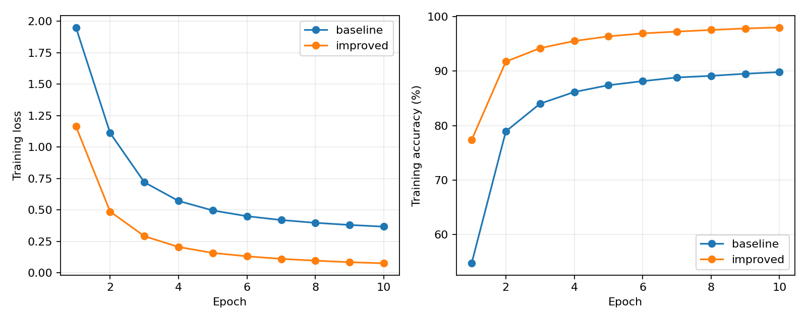
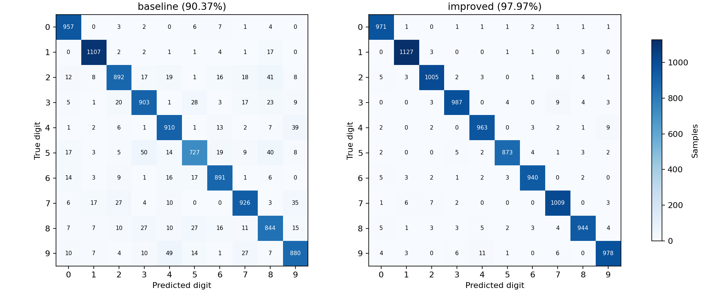
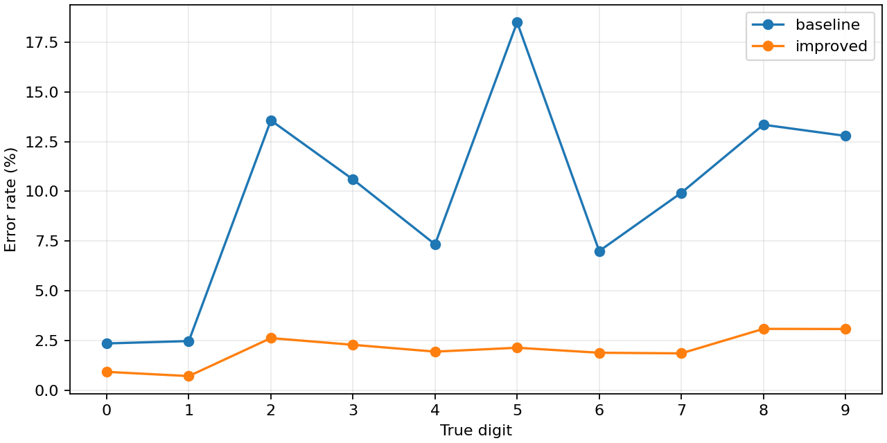

# 实验四：多层感知机识别 MNIST 


## 一、实验目的

1. 使用 PyTorch 实现多层感知机，理解输入展平、前向传播、交叉熵损失和反向传播。
2. 在相同的 MNIST 训练集和测试集上比较两组模型配置。
3. 根据训练曲线、测试准确率和混淆矩阵分析模型的分类表现。

## 二、实验环境与运行方法

- 实验代码见 [code.ipynb](code.ipynb)


```powershell
python -m pip install torch==2.9.1+cpu torchvision==0.24.1+cpu --index-url https://download.pytorch.org/whl/cpu
python -m pip install matplotlib jupyterlab
python -m jupyterlab
```

在 JupyterLab 打开 `4th.exp/code.ipynb`，选择与安装依赖相同的 Python 内核，然后选择 **Restart Kernel and Run All Cells**。每次完整运行会在 `4th.exp/result/` 下写入一个独立批次，包含指标和图表。数据缓存位于 `4th.exp/data/`。

## 三、实验内容

### 1. 准备数据

MNIST 包含 60,000 张训练图像和 10,000 张测试图像。每张图像是 28×28 的灰度图，标签为 0 至 9。使用 `ToTensor()` 将像素缩放至 [0, 1]，模型入口将图像展平为 784 维向量。

### 2. 构建模型

| 配置 | 基础模型 | 改进模型 |
| --- | --- | --- |
| 全连接层维度 | 784 → 128 → 10 | 784 → 256 → 128 → 64 → 10 |
| 隐藏层激活 | ReLU | GELU |
| 批归一化 | 无 | 三个隐藏层均使用 BatchNorm |
| 随机失活 | 无 | 前两个隐藏层使用 Dropout(0.3) |
| 优化器与学习率 | SGD，0.1 | Adam，0.001 |

### 3. 训练与测试

两组模型使用同一训练集、批大小 2048、随机种子 42 和 10 轮训练。每个批次将模型输出的 10 个 logits 直接输入交叉熵，通过反向传播计算梯度，再由优化器更新参数。训练结束后切换到评估模式，在同一测试集上统计按样本平均的交叉熵和准确率。

## 四、实验结果与分析

在 Python 3.14.0、PyTorch 2.9.1+cpu 的 CPU 环境中完成两组各 10 轮训练。下表和图片均来自同一[运行批次的指标文件](result/20261105-134318-071256/metrics.json)。

| 指标 | 基础模型 | 改进模型 |
| --- | ---: | ---: |
| 第 1 轮训练损失 | 1.9502 | 1.1637 |
| 第 10 轮训练损失 | 0.3678 | 0.0766 |
| 测试损失 | 0.3446 | 0.0687 |
| 测试准确率 | 90.37% | 97.97% |
| 正确分类数（共 10,000 张） | 9,037 | 9,797 |

在本次测试中，改进模型比基础模型多正确分类 760 张图像，准确率提高 7.60 个百分点。两组训练损失均下降，改进模型的第 10 轮训练损失更低。

基础模型最常见的单向误判是把 5 识别为 3，共 50 张。

改进模型最常见的单向误判是把 9 识别为 4，共 11 张。







混淆矩阵的行是真实类别，列是预测类别。对角线记录正确分类数，非对角线记录数字间的混淆。逐类错误率以每个真实类别的样本数为分母，可用于比较两组模型在哪些数字上仍容易误判。

## 五、实验总结

本实验将 MNIST 图像分类分为数据处理、模型训练和测试评估三个环节。两组配置同时调整了网络结构、激活函数、正则化和优化器，测试结果反映整套配置的差异。
