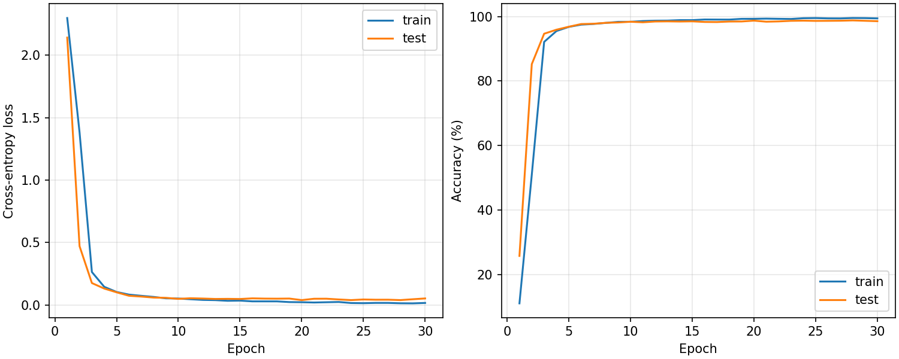
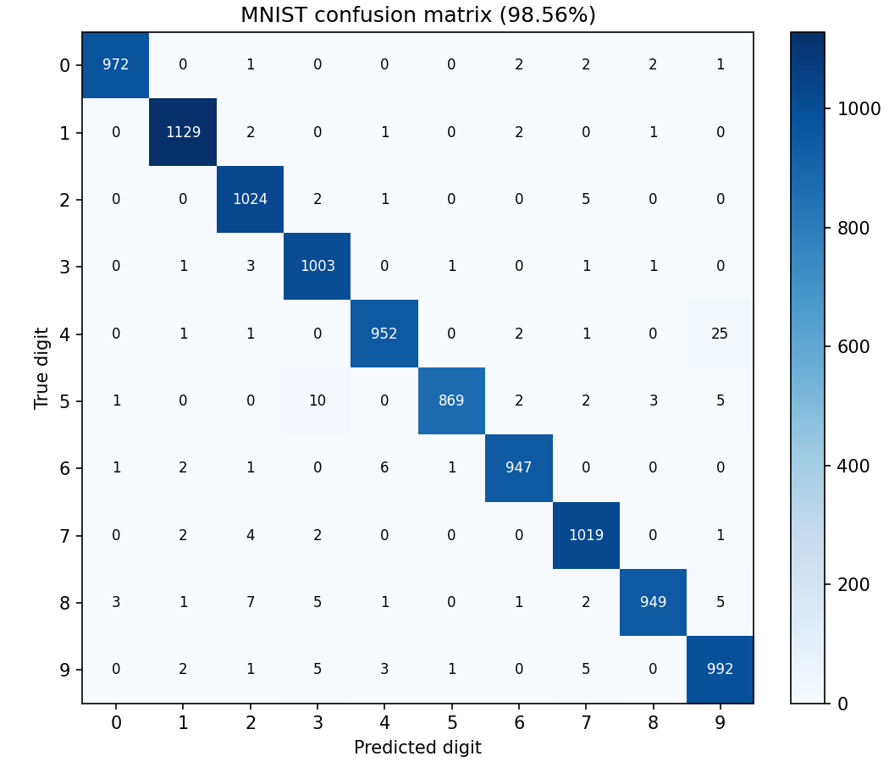
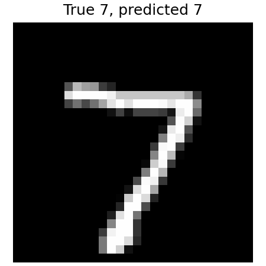
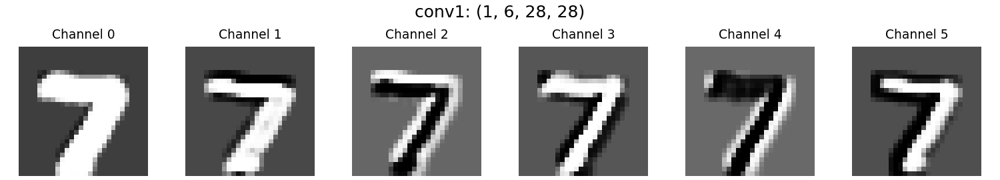
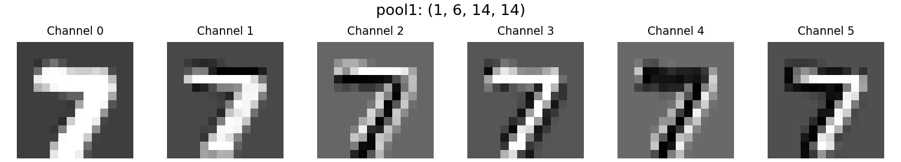
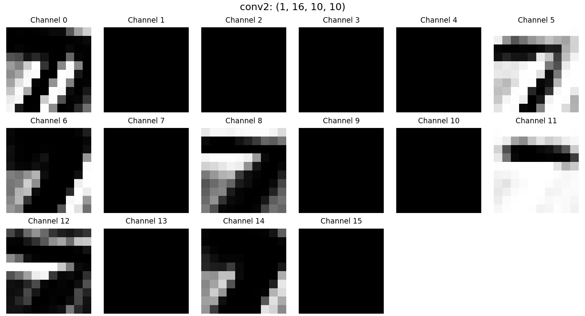

# 实验五：CNN 卷积神经网络

姓名：________　学号：________　班级：________

> 实验代码见 [code.ipynb](code.ipynb)，实测图表、模型权重与指标位于 [result/20261119-134819-193069](result/20261119-134819-193069/metrics.json)。

## 一、实验目的

本实验基于 LeNet 风格的卷积神经网络完成 MNIST 手写数字分类，掌握卷积层、激活函数、平均池化层和全连接层的作用。通过记录训练过程、绘制混淆矩阵并查看各层特征图，理解图像从像素到分类输出的处理过程。

## 二、实验内容

### 1. 实验环境与运行方法

本次实测使用 Python 3.14.0、PyTorch 2.9.1+cpu 和 CPU。Notebook 可自动选择可用的 CUDA。以下命令从仓库根目录运行，安装 CPU 版依赖并启动 JupyterLab。

```powershell
python -m pip install torch==2.9.1+cpu torchvision==0.24.1+cpu --index-url https://download.pytorch.org/whl/cpu
python -m pip install numpy matplotlib jupyterlab
python -m jupyterlab
```

打开 `5th.exp/code.ipynb`，选择安装上述依赖的 Python 内核，执行 **Restart Kernel and Run All Cells**。首次运行需要联网下载 MNIST，后续复用 `5th.exp/data/` 缓存。每次完整运行创建新的 `result/时间戳/` 目录。

### 2. 设置超参数并加载数据

训练集含 60,000 张图像，测试集含 10,000 张图像，每张图像为 28×28 单通道灰度图，标签为 0 至 9。`ToTensor()` 将像素缩放至 [0, 1]。训练集打乱，测试集保持固定顺序。

| 参数 | 设置 |
| --- | --- |
| 批大小 | 512 |
| 训练轮数 | 30 |
| 优化器 | Adam |
| 学习率 | 0.01 |
| 随机种子 | 42 |
| 可训练参数量 | 61,706 |

### 3. 创建模型

沿用参考代码中的两层卷积、Sigmoid 激活、平均池化和三层全连接结构。每层的数据形状如下，省略批次维度。

| 处理阶段 | 主要操作 | 输出形状 |
| --- | --- | --- |
| 输入 | 灰度图 | 1×28×28 |
| Conv1 | 5×5 卷积，padding=2，Sigmoid | 6×28×28 |
| Pool1 | 2×2 平均池化，stride=2 | 6×14×14 |
| Conv2 | 5×5 卷积，Sigmoid | 16×10×10 |
| Pool2 | 2×2 平均池化，stride=2 | 16×5×5 |
| 展平 | 展开空间与通道维度 | 400 |
| FC1 | 全连接，Sigmoid | 120 |
| FC2 | 全连接，Sigmoid | 84 |
| 分类层 | 全连接 | 10 |

分类层输出 logits，训练时直接传入交叉熵损失函数。预测类别取 logits 最大值对应的下标。

### 4. 训练与测试

训练时依次清空梯度、前向传播、计算损失、反向传播并更新参数。每轮结束切换至评估模式，在关闭梯度的条件下遍历测试集。平均损失按样本数加权，避免最后一批样本数不足时产生统计偏差。

为复现课程流程，每轮记录训练与测试指标，最终结果使用第 30 轮模型。测试集参与了逐轮观测，因此这些结果应作为课程实验的描述性评估。

### 5. 可视化

保存训练与测试曲线、最终混淆矩阵，以及固定测试图像在 Conv1、Pool1、Conv2、Pool2 处的全部通道。特征图统一使用 [0, 1] 的灰度范围，便于查看 Sigmoid 输出和平均池化后的数值分布。

## 三、实验结果与分析

### 1. 训练过程与最终测试结果

以下数据均来自本次完整运行的 [metrics.json](result/20261119-134819-193069/metrics.json)。

| 指标 | 第 1 轮 | 第 30 轮 |
| --- | ---: | ---: |
| 训练损失 | 2.2968 | 0.0169 |
| 训练准确率 | 11.09% | 99.43% |
| 测试损失 | 2.1403 | 0.0528 |
| 测试准确率 | 25.80% | 98.56% |

最终模型在 10,000 张测试图像中正确分类 9,856 张，误判 144 张。训练损失后期总体降低，测试准确率在约 98% 至 99% 之间波动，第 28 轮为 98.80%，第 30 轮回落至 98.56%。训练集上的改善未持续转化为测试集上的改善，说明后期继续训练的收益有限。单次运行的曲线不足以保证其他随机种子下的表现。



### 2. 混淆矩阵

矩阵的行表示真实类别，列表示预测类别。对角线元素之和为正确分类数量。本次出现次数最多的三种单向误判如下。

| 真实数字 | 预测数字 | 误判数量 |
| --- | --- | ---: |
| 4 | 9 | 25 |
| 5 | 3 | 10 |
| 8 | 2 | 7 |



### 3. 卷积与池化特征图

选取测试集第 0 张图像，真实标签为 7，预测为 7。各层图来自同一输入和最终训练模型。










第一层包含 6 个通道，第二层包含 16 个通道，不同通道对同一图像产生不同的响应。两次平均池化分别把空间尺寸从 28×28 压缩到 14×14、从 10×10 压缩到 5×5。特征图展示了网络中间表示的变化，单张图像的响应不能唯一确定每个通道学到的语义。

## 四、实验总结与心得

本实验完成了 MNIST 数据加载、卷积网络构建、训练测试与中间特征可视化。卷积层通过局部连接和权重共享处理图像，平均池化降低空间分辨率，全连接层将特征映射到十类分类输出。混淆矩阵进一步提供了每种数字的误判分布，使整体准确率能够与具体错误对应起来。

通过分步骤实现训练与评估流程，可以明确区分梯度更新与测试统计，并利用保存的逐轮指标、模型权重和图表复查本次结果。

参考资料为[课程实验五文档](https://github.com/Guyudong1/CV_exp/blob/main/5th.exp/README.md)和[课程原始 Notebook](https://github.com/Guyudong1/CV_exp/blob/main/5th.exp/code.ipynb)。本实验依照其模型和超参数整理，补齐输出目录初始化、分步骤说明和实测结果记录。
